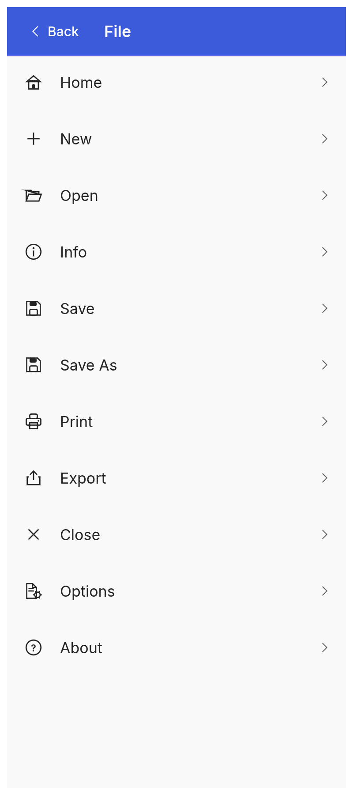
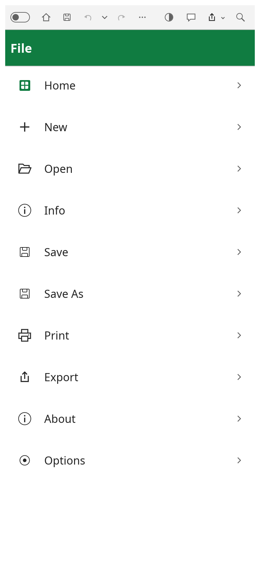
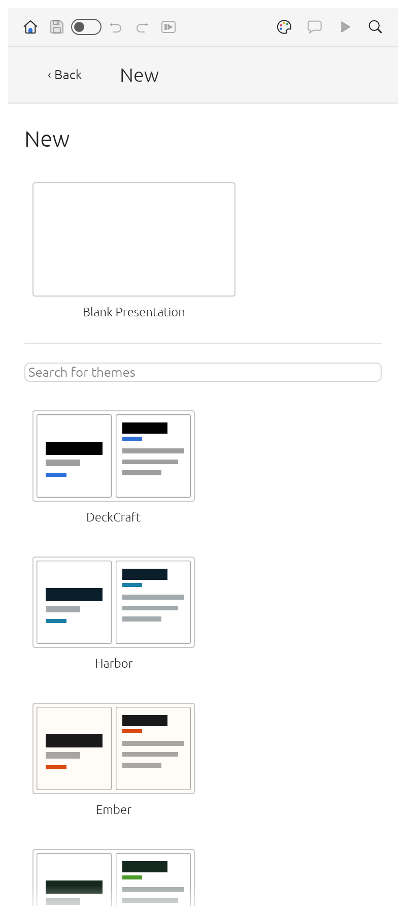

<div dir="rtl" align="center">

# رستینا آفیس (Rustina Office)

**مجموعه آفیس قدرتمند دسکتاپ، بازنویسی‌شده با زبان راست (Rust) و بهینه‌سازی‌شده برای اندروید.**

واژه‌پرداز (Write) · صفحه‌گسترده (Tables) · اسلاید و ارائه (Slides) · نقشه‌کشی (Draw)

[English](README.md) · [فارسی](README.fa.md) · [Write](Write/README.md) · [Tables](Tables/README.md) · [Slides](Slides/README.md) · [Draw](Draw/README.md)

[-3ddc84?style=for-the-badge&logo=android&logoColor=white)](https://github.com/RustinaCo/Office/releases)
[](https://www.rust-lang.org/)
[](LICENSE)
[](https://github.com/RustinaCo/Office/releases/tag/v1.1.0)
[](#چرا-رستینا-آفیس)
[](#چرا-رستینا-آفیس)

### 📲 [دانلود مستقیم برنامه‌ها (نسخه رسمی v1.1.0)](https://github.com/RustinaCo/Office/releases/tag/v1.1.0)

| برنامه | کاربرد و پسوندها | حجم فایل | لینک دانلود مستقیم |
| :--- | :--- | :--- | :--- |
| **Rustina Write** | واژه‌پرداز اسناد (`.docx`, `.odt`, `.txt`, `.pdf`) | **۱۹.۱ مگابایت** | [⬇️ دانلود مستقیم APK](https://github.com/RustinaCo/Office/releases/download/v1.1.0/Rustina-Write-1.1.0.apk) |
| **Rustina Tables** | اکسل و جداول محاسباتی (`.xlsx`, `.csv`, `.tsv`, `.pdf`) | **۹.۴ مگابایت** | [⬇️ دانلود مستقیم APK](https://github.com/RustinaCo/Office/releases/download/v1.1.0/Rustina-Tables-1.1.0.apk) |
| **Rustina Slides** | پاورپوینت و ارائه‌ها (`.pptx`, `.pdf`, `.png`) | **۱۳.۰ مگابایت** | [⬇️ دانلود مستقیم APK](https://github.com/RustinaCo/Office/releases/download/v1.1.0/Rustina-Slides-1.1.0.apk) |

</div>

---

<div dir="rtl">

## 🚀 تغییرات نسخه جدید (v1.1.0 — ارگونومی لمسی و پشتیبانی فارسی)

- **موتور بازآرایی و چیدمان متن فارسی و عربی (BiDi Engine)**:
  - رفع کامل مشکل معکوس شدن ترتیب کلمات در اکسل (Tables) هنگام تایپ فارسی و عربی.
  - پیاده‌سازی ماژول دوجهته پیشرفته با `unicode-bidi` و اتصال حروفِ HarfBuzz در سلول‌ها، ویرایشگر درون‌سلولی و فرمول‌بار.
- **اسکرول دو انگشتی طبیعی (Two-Finger Pan)**:
  - اتصال ورودی چندلمسی به سیستم اسکرول در تمام برنامه‌ها جهت جابجایی آزاد در هر دو جهت افقی و عمودی بدون نیاز به لمس اسکرول‌بار باریک.
- **تفکیک لمسِ اسکرول از سلکت در جداول (Tables)**:
  - کشیدن تک‌انگشت به جابجایی نرم صفحه اختصاص یافت و انتخاب ناخواسته سلول‌ها حذف شد.
  - هندل گوشه سلول (Fill Handle) به ابعاد بزرگ ۳۲ پیکسلی ارتقا یافت تا انتخاب بازه‌ای به آسانی با لمس انگشت انجام گیرد.
- **ریبون پیش‌فرض بسته در موبایل**:
  - در حالت عمودی گوشی، نوار ریبون بالای صفحه به طور پیش‌فرض جمع شده تا حداکثر فضای صفحه به محتوای سند یا جدول اختصاص یابد و با یک لمس باز شود.
- **ژست‌های ورقی اسلاید (Slides)**:
  - تعویض و ورق زدن اسلایدها با سوایپ دو انگشت در حالت اندازه واقعی، و حرکت نرم روی اسلاید در حالت زوم.
- **مدیریت مصرف باتری و فریم‌ریت**:
  - رندر واکنشی و بهینه‌سازی حلقه رویداد اندروید (`ControlFlow::Wait`) تا پردازنده و GPU در زمان عدم لمس به حالت خواب رفته و از داغ شدن دستگاه و افت باتری جلوگیری شود.
- **توزیع استاندارد و سبک مخزن**:
  - حذف بسته‌های حجیم نصبی از تاریخچه گیت و انتقال فایل‌های نصبی (APK) به بخش اختصاصی GitHub Releases جهت کاهش ۹۰ درصدی حجم کلون مخزن.

---

## چرا رستینا آفیس؟

- **هیچ حساب کاربری‌ای لازم نیست.** نه ثبت‌نام، نه ورود — بین شما و فایلتان هیچ صفحه ورود یا وابستگی به اینترنت وجود ندارد.
- **بدون تبلیغات، بدون تله‌متری و بدون دسترسی به اینترنت.** برنامه‌ها هیچ درخواستی برای اتصال به اینترنت در اندروید ندارند و کاملاً امن هستند.
- **فوق‌العاده کم‌حجم.** حجم ۹.۴ تا ۱۹ مگابایت به همراه تمام فونت‌ها، کسری از حجم برنامه‌های مایکروسافت ۳۶۵ یا گوگل درایو است.
- **قالب‌های استاندارد.** فایل‌های `.docx`، `.xlsx` و `.pptx` بدون تغییر به فرمت‌های واسطه، مستقیماً باز، ویرایش و ذخیره می‌شوند.
- **۱۰۰٪ آفلاین.** ویرایش، ذخیره‌سازی، گرفتن خروجی PDF و اجرای اسلایدشو حتی در حالت پرواز کار می‌کند.
- **فایل‌های شما در کنترل شماست.** پشتیبانی مستقیم از حافظه داخلی، کارت حافظه و فضاهای ابری از طریق انتخاب‌گر استاندارد فایل اندروید.
- **قدرت کامل نسخه دسکتاپ روی موبایل.** همان تب‌ها، فرمول‌ها و تنظیمات نسخه دسکتاپ به شکل اختصاصی برای تعامل لمسی بازطراحی شده‌اند.
- **پشتیبانی کامل از متن فارسی.** چینش راست‌به‌چپ (RTL)، اتصال درست حروف، و همراه داشتن ۲۲ فونت استاندارد فارسی با مجوز آزاد.

---

## معرفی برنامه‌ها

<div align="center">

| **[Rustina Write](Write/README.md)** | **[Rustina Tables](Tables/README.md)** | **[Rustina Slides](Slides/README.md)** |
|:---:|:---:|:---:|
| <a href="Write/README.md"></a> | <a href="Tables/README.md"></a> | <a href="Slides/README.md"></a> |
| **واژه‌پرداز حرفه‌ای** | **صفحه‌گسترده و محاسبات** | **طراحی و نمایش اسلاید** |

</div>

- **[Rustina Write](Write/README.md) — اسناد:** استایل‌ها، قالب‌بندی پاراگراف، جداول، سرصفحه و پاصفحه، رد تغییرات (Track Changes)، فرمول‌ها، تصاویر و اشکال، و خروجی مستقیم PDF.
- **[Rustina Tables](Tables/README.md) — اکسل و جداول:** استایل سلول‌ها، قالب عددی، فرمت‌های شرطی، فیلترها، گراف محاسباتی با **بیش از ۵۰۰ تابع**، آرایه‌های پویا، جدول محوری (PivotTable) و ۱۷ نوع نمودار.
- **[Rustina Slides](Slides/README.md) — ارائه:** اسلایدهای مادر، تم‌های متنوع، اشکال هندسی، گرادیان، انیمیشن‌ها و ترنزیشن‌ها (شامل Morph)، و حالت نمایش مجری.
- **[Rustina Draw](Draw/README.md) — نقشه‌کشی:** ترسیمات دوبعدی مهندسی، اسنپ‌ها، لایه‌بندی، اندازه‌گذاری و پشتیبانی از فایل‌های DXF/DWG در ابعاد موبایل.

---

## جدول مقایسه

| ویژگی | **رستینا آفیس** | Microsoft 365 موبایل | Google Docs / Sheets |
| :--- | :--- | :--- | :--- |
| **نیاز به حساب** | **ندارد** | نیاز به حساب مایکروسافت | نیاز به حساب گوگل |
| **هزینه** | **رایگان و متن‌باز (MIT)** | رایگان محدود با اشتراک پریمیوم | رایگان پایه با اشتراک فضای ابری |
| **کارکرد آفلاین** | **همیشگی (بدون دسترسی شبکه)** | نیاز به ورود و اتصال گاه‌به‌گاه | نیاز به فعال‌سازی حالت آفلاین |
| **تبلیغات / رهگیری** | **صفر** | جمع‌آوری عیب‌یابی | تحلیل رفتار کاربری گوگل |
| **حجم برنامه** | **۹.۴ تا ۱۹ مگابایت** | بیش از ۲۰۰ مگابایت | همراه با اپ سنگین درایو |
| **فرمت بومی** | **`.docx`, `.xlsx`, `.pptx`** | بومی | تبدیل به فرمت داخلی گوگل |

---

## کامپایل از سورس‌کد

```bash
# ۱. نصب تارگت اندروید در راست
rustup target add aarch64-linux-android
cargo install cargo-apk2

# ۲. معرفی مسیر Android SDK و NDK
export ANDROID_HOME=$HOME/Android/Sdk
export ANDROID_NDK_HOME=$HOME/Android/Sdk/ndk/<version>

# ۳. کامپایل APK برای هر یک از برنامه‌ها (مثلاً Tables):
cd Tables/grid-android
cargo apk2 build --lib --release
```

---

## مجوز و کپی‌رایت

این پروژه تحت مجوز **MIT** منتشر شده است. جزییات در فایل [`LICENSE`](LICENSE) و قدردانی از توسعه‌دهندگان اولیه در [`CREDITS.md`](CREDITS.md) مستند شده است.

</div>
