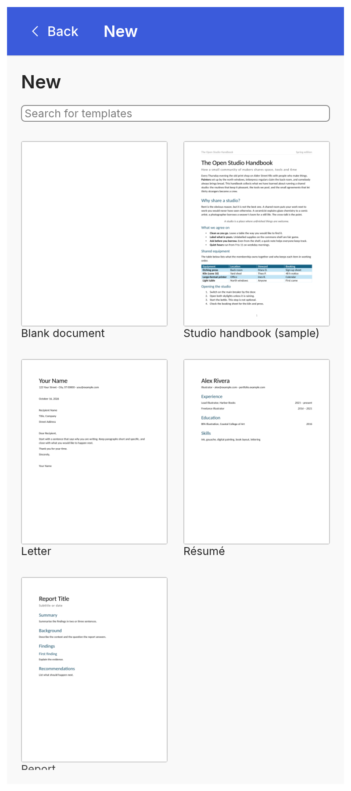
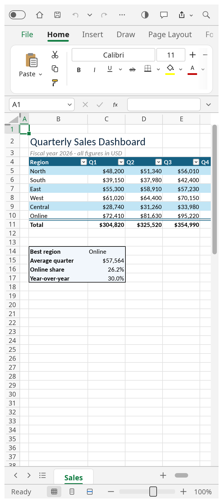
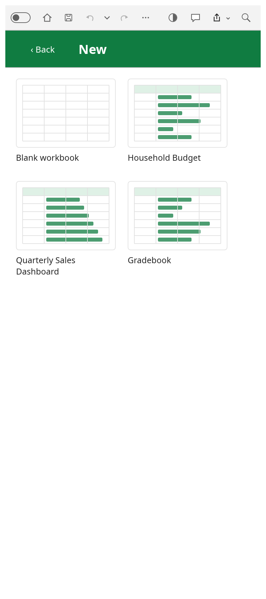
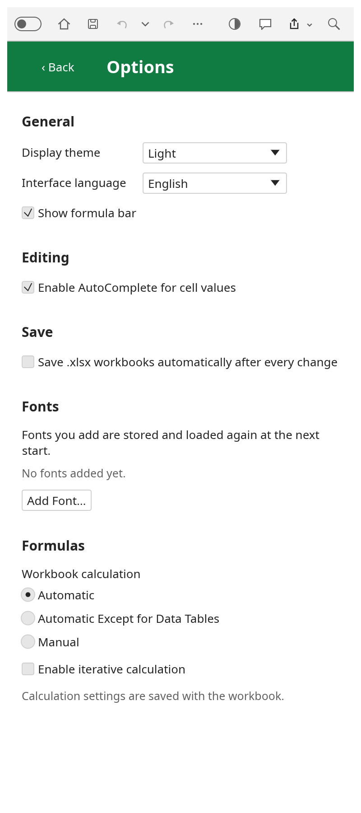

<div dir="rtl" align="center">

# رستینا آفیس

**مایکروسافت آفیس، روی گوشی‌ات — همان سه برنامه، همان ریبون و همان تنظیمات نسخه کامپیوتری، سبک و
سریع برای اندروید.**

[English](README.md) · [فارسی](README.fa.md) · [Write](Write/README.md) · [Tables](Tables/README.md) · [Slides](Slides/README.md)

</div>

---

<div dir="rtl">

## این پروژه چیست

رستینا آفیس سه اپ اندرویدی است که همان گردش‌کار نسخه کامپیوتری را به گوشی می‌آورد:

| برنامه | چیست | باز کردن | ذخیره |
|---|---|---|---|
| **[Rustina Write](Write/README.md)** | واژه‌پرداز — سند، استایل، جدول، رد تغییرات، ارجاع‌ها، ادغام پستی | `.docx`، `.txt`، `.md`، `.html`، `.rtf`، `.odt` | `.docx`، `.pdf`، `.txt`، `.html` |
| **[Rustina Tables](Tables/README.md)** | صفحه‌گسترده — فرمول، قالب‌بندی، جدول، نمودار، ابزارهای داده | `.xlsx`، `.csv` | `.xlsx`، `.csv`، `.pdf` |
| **[Rustina Slides](Slides/README.md)** | ارائه — تم، طرح‌بندی، شکل، تصویر، نمودار، انتقال، انیمیشن، نمایش اسلاید | `.pptx` | `.pptx`، `.pdf` |

کل مجموعه با **Rust** نوشته شده — یک موتور، یک رابط کاربری، سه برنامه — و نسخه اندروید دقیقاً همان
رابط نسخه کامپیوتری را استفاده می‌کند: ریبون، تب‌ها، پنجره‌ها و همهٔ تنظیمات. هیچ‌چیز نسخهٔ کم‌وبیش
«موبایلی» نیست.

<div align="center">

| **Write** — صفحهٔ فایل | سند | سند جدید | تنظیمات |
|---|---|---|---|
|  |  |  |  |
| **Tables** — صفحهٔ فایل | صفحه‌گسترده | کارپوشهٔ جدید | تنظیمات |
|  |  |  |  |
| **Slides** — صفحهٔ فایل | اسلاید | ارائهٔ جدید | نمایش اسلاید |
|  |  |  |  |

</div>

## چرا به کار می‌آید

- **مدیریت فایل‌های لپ‌تاپ از روی گوشی، هر جای دنیا، بدون دغدغه.** اگر پوشه‌ای که با آن کار می‌کنی روی
  گوشی هم همگام باشد (گوگل درایو، وان‌درایو، دراپ‌باکس، نکست‌کلود، سینک‌تینگ، NAS و…) برنامه‌ها
  مستقیماً از طریق مدیریت فایل اندروید در همان پوشه باز و ذخیره می‌کنند؛ بدون ایمپورت/اکسپورت و بدون
  «اشتراک‌گذاری به برنامه، ویرایش، اشتراک‌گذاری برگردان».
- **همهٔ آپشن‌ها دقیقاً مثل نسخهٔ کامپیوتری.** همان تب‌های ریبون، همان پنجره‌ها، همان تنظیمات. اگر
  ورد و اکسل و پاورپوینت را می‌شناسی، این‌ها را هم می‌شناسی.
- **سبک و سریع.** یک برنامهٔ بومی Rust است: در یک لحظه بالا می‌آید، با نرخ تصویر گوشی اسکرول می‌کند و
  حجمش چند مگابایت است — با فونت‌ها.
- **کارت از بین نمی‌رود.** ذخیرهٔ خودکار فایل را به‌روز نگه می‌دارد و دکمهٔ Back اندروید پیش از بستن
  سندی که تغییر ذخیره‌نشده دارد، مثل بستن سند روی کامپیوتر، می‌پرسد **ذخیره / ذخیره نکن / لغو**.
- **فارسی و عربی، درست.** ۲۲ خانوادهٔ فونت فارسی/عربی (به‌همراه پنج فونت لاتین هم‌اندازه) با مجوز باز همراه برنامه می‌آید، متن
  راست‌به‌چپ درست چیده می‌شود و هر فونتی که خودت داشته باشی را می‌توانی با **افزودن فونت…** اضافه کنی
  که همیشه نصب می‌ماند.

## نصب

**این نخستین نسخه است.** این سه برنامه تازه‌اند؛ هر جا باگی دیدی لطفاً در
[ایشوی همین مخزن](https://github.com/RustinaCo/Office/issues) — همراه با کاری که کردی، مدل گوشی و
نسخهٔ اندروید — گزارش بده تا سریع حل شود.

۱. APK مورد نظر را از [**ریلیز v1.0.2**](https://github.com/RustinaCo/Office/releases/tag/v1.0.2) دانلود کن.

۲. روی گوشی بازش کن و وقتی اندروید اجازه خواست، نصب از این منبع را تأیید کن.

۳. تمام — بدون حساب کاربری، بدون تبلیغ، بدون تله‌متری، بدون دسترسی به شبکه.

**نیازمندی‌ها:** اندروید ۱۰ (API 29) یا جدیدتر، arm64-v8a. برنامه فقط به فایل‌هایی که خودت از
طریق انتخاب‌گر سیستم بدهی دسترسی می‌گیرد.

## نسخهٔ اندروید چه چیزی را عوض کرده

همهٔ موارد زیر روی نسخهٔ کامپیوتری افزوده شده و چیدمان دسکتاپ دست‌نخورده مانده است.

- **صفحهٔ فایل، بازطراحی‌شده برای انگشت.** گوشی روی **File** باز می‌شود: یک لیست تمام‌صفحه از
  مقصدها (Home, New, Open, Info, Save, Save As, Print, Export, About, Options) — همان لیست، هم روی
  صفحهٔ اول بعد از اسپلش و هم وقتی از داخل سند روی **File** می‌زنی. روی هرکدام بزنی، همان یک صفحهٔ
  تمام‌صفحه را می‌گیری؛ **Back** به لیست برمی‌گردد. منوی شروع قبلی حذف شده و Close هم نیست: روی گوشی
  سند با Back اندروید بسته می‌شود.
- **دکمهٔ Back اندروید درست کار می‌کند.** اول کیبورد را می‌بندد، بعد صفحه یا پنجرهٔ رویی، و داخل سند
  اگر تغییر ذخیره‌نشده باشد می‌پرسد **ذخیره / ذخیره نکن / لغو**. روی خود لیست فایل، **Back** وقتی
  می‌آید که سندی پشتش باشد؛ روی صفحهٔ اول برنامه نمایش داده نمی‌شود و Back در آن حالت از برنامه بیرون
  می‌آید.
- **ذخیرهٔ خودکار واقعی.** به‌محض اینکه سند فایلی داشته باشد، کلید AutoSave در نوار بالا فعال می‌شود
  و فایل را به‌روز نگه می‌دارد.
- **کیبورد سر جای خودش می‌ماند.** تاپ روی صفحه کیبورد را می‌آورد؛ تاپ روی هر دکمهٔ تولبار یا منو
  کیبورد را می‌بندد و بسته نگه می‌دارد.
- **هدف‌های لمسی بزرگ.** دکمه‌های قدبلند در همهٔ تب‌ها جز Home (که چیدمان دو ردیفی واقعی خودش را
  نگه می‌دارد)، تب‌های قرص‌شکل و فوتر با کنترل صفحه و بزرگ‌نمایی.

## ساخت از سورس

هر پوشه یک زوج کامل است: برنامهٔ چندسکویی به‌همراه پوستهٔ اندروید. تنها چیز بیرونی، پوشهٔ فونت‌های
همراه است که داخل خود هر پوشه قرار دارد.

```bash
rustup target add aarch64-linux-android
cargo install cargo-apk

cd Write/word-android
export ANDROID_HOME=$HOME/Android/Sdk
export ANDROID_NDK_ROOT=$HOME/Android/Sdk/ndk/<version>
cargo apk build --lib --release     # cargo-apk ≥ 0.10: cargo apk2 build --lib --release
```

نسخهٔ دسکتاپ هم با `cargo run --release -p wordcraft` (یا `gridcraft` و `deckcraft`) روی لینوکس، مک،
ویندوز و BSD بالا می‌آید و همان کدها به وب‌اسمبلی هم کامپایل می‌شوند.

## قدردانی

این مجموعه روی کار متن‌باز **تیم ArtCraft** بنا شده — موتور و رابط اصلی و کلین‌روم WordCraft /
GridCraft / DeckCraft — با مجوز MIT OR Apache-2.0. دستشان درد نکند.
متن کامل قدردانی و لینک‌ها: [`CREDITS.md`](CREDITS.md).

## مشارکت

از مشارکت خیلی استقبال می‌شود:

- **گزارش اشکال** همراه با مدل گوشی، نسخهٔ اندروید و کاری که انجام دادی.
- **ترجمه‌ها** (رابط چندزبانه است؛ فارسی و انگلیسی در اولویت‌اند).
- **فونت‌ها**: خانواده‌های بیشتری با مجوز باز برای فارسی، عربی و اردو.
- **Pull Request**: چیدمان دسکتاپ باید سالم بماند و همراه تغییر، تست یا اسکرین‌شات بیاید.

[ایشو](https://github.com/RustinaCo/Office/issues) یا Pull Request باز کن. با مشارکت، قبول می‌کنی
که کارت با مجوز MIT پایین منتشر شود.

## مجوز

MIT — فایل [`LICENSE`](LICENSE). برنامه‌های بالادستی MIT OR Apache-2.0 هستند و متن مجوزشان کنار
سورس هر برنامه نگه داشته شده (`LICENSE-MIT` و `LICENSE-APACHE`).

</div>
