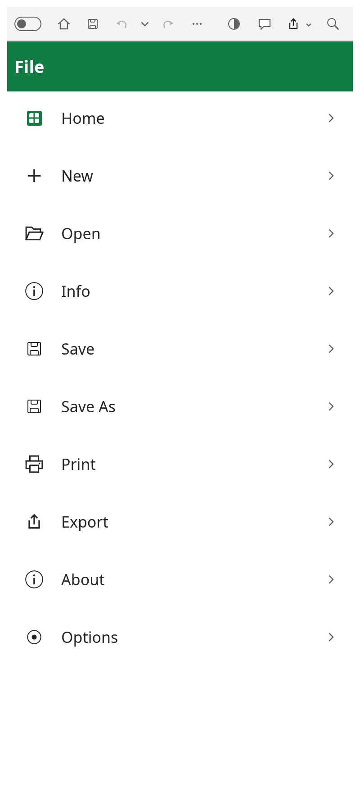
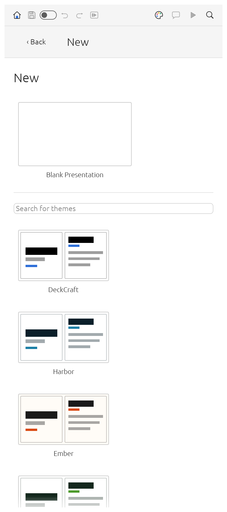

<div align="center">

# Rustina Office

**Microsoft Office, on your phone — the same three apps, the same ribbon, the same options as the
desktop, rebuilt lightweight for Android.**

[English](README.md) · [فارسی](README.fa.md) · [Write](Write/README.md) · [Tables](Tables/README.md) · [Slides](Slides/README.md)

-3ddc84?style=flat-square&logo=android&logoColor=white)


**Download — direct APK links:**
[**Rustina Write** · 18.3 MB](https://github.com/RustinaCo/Office/raw/v1.0.2/apk/Rustina-Write-1.0.2.apk) ·
[**Rustina Tables** · 9.4 MB](https://github.com/RustinaCo/Office/raw/v1.0.2/apk/Rustina-Tables-1.0.2.apk) ·
[**Rustina Slides** · 12.8 MB](https://github.com/RustinaCo/Office/raw/v1.0.2/apk/Rustina-Slides-1.0.2.apk)

</div>

---

## Why Rustina Office?

- **No account, ever.** Nothing to sign up for and nothing to sign into — there is no login between
  you and your file.
- **No ads, no telemetry, and no network permission at all.** Android will not let these apps phone
  home, because they never ask for the permission.
- **Small.** 18.3 MB / 9.4 MB / 12.8 MB per app, fonts included — a fraction of the size of the
  mainstream suites.
- **It opens the real files.** `.docx`, `.xlsx`, `.pptx` and friends open, edit and save back in the
  same format — the work you already have on your computer opens here.
- **Fully offline.** Edit, save, export a PDF and even run a slide show with the phone in aeroplane
  mode. Nothing waits for a connection.
- **Your files stay where they are.** Open and save in any folder Android's file picker can see,
  including Google Drive, OneDrive, Dropbox, Nextcloud, Syncthing or a NAS — no import/export dance,
  no "share to the app, edit, share back".
- **The whole desktop, not a mobile cut-down.** The same ribbon tabs, the same dialogs and the same
  options as the desktop apps; if you know Word, Excel or PowerPoint, you already know these.
- **Persian written properly; the interface is English.** Persian, Arabic and Urdu *documents* are
  first-class — right-to-left paragraphs, correct letter joining and bidirectional runs — with 22
  open-licensed Persian/Arabic font families and five metric-compatible Latin ones compiled in. The
  interface itself is English today (Write follows your system language across 19 translations, Tables
  10, Slides English for now); a Persian interface is the first thing on the list — see Contributing.
- **Fonts: bring your own, too.** **Add Font…** in Options takes any family already on your phone —
  B Nazanin, B Titr, B Yekan, IRANSans and the rest — and puts it in the font list of Write, Tables
  and Slides, alongside the 27 bundled families.
- **Open source, in Rust.** One engine, one UI, three apps, MIT-licensed — and the same source builds
  the desktop versions (Linux, macOS, Windows, BSD) and the web.
- **Android 10 (API 29) or newer, arm64-v8a**, side-loaded, no Play Store account needed.

## The three apps

One engine, one UI, three apps. The Android build reuses the *same* desktop front end — ribbon, tabs,
dialogs and every option — laid out for a touch screen. Nothing here is a stripped-down "mobile
edition".

<div align="center">

| **[Rustina Write](Write/README.md)** | **[Rustina Tables](Tables/README.md)** | **[Rustina Slides](Slides/README.md)** |
|---|---|---|
| <a href="Write/README.md"></a> | <a href="Tables/README.md"></a> | <a href="Slides/README.md"></a> |
| Word processor | Spreadsheet | Presentations |

</div>

- **[Rustina Write](Write/README.md) — documents.** Styles, full paragraph and page formatting,
  tables and columns, headers and footers, lists, footnotes, comments, track changes, find and
  replace, spell check. Long documents: navigation pane, table of contents, captions, cross
  references, index, citations and bibliography, mail merge from CSV. Objects: pictures, shapes and
  text boxes, WordArt, charts, equations, symbols, hyperlinks. Opens `.docx`, `.txt`, `.md`, `.html`,
  `.rtf`, `.odt`; saves `.docx`, exports `.pdf`, `.txt`, `.html`.
- **[Rustina Tables](Tables/README.md) — spreadsheets.** Cell styles, Excel's full number-format
  language, conditional formatting, borders and fills, frozen panes, merged cells, the fill handle,
  sorting and AutoFilter, data validation, outlining, Flash Fill, text to columns. A dependency-graph
  calculation engine with dynamic arrays and **500+ worksheet functions**, plus `LET`, `LAMBDA`,
  `MAP`, `REDUCE`, `SCAN`, `BYROW`, `BYCOL` and `MAKEARRAY`. Tables, PivotTables, 17 chart types,
  sparklines, pictures, shapes and comments. Opens and saves `.xlsx` (styles, formulas, tables,
  charts, PivotTables and print settings all round-trip) and `.csv`/`.tsv`; `.xls` opens with its
  values, formulas and number formats; exports `.pdf`.
- **[Rustina Slides](Slides/README.md) — presentations.** Slide masters and eleven layouts, eight
  original themes, sections and notes, 150+ preset shapes, connectors, freeform, curve and scribble
  tools, merge shapes, gradient and picture fills, in-place text editing, tables, charts, SmartArt
  basics, audio and video. Transitions (including Morph), animations and by-paragraph builds, a
  full-screen slide show with presenter view and a pen, rehearse timings. Opens and saves `.pptx`;
  exports PDF (slides, notes pages, handouts), PNG/JPEG and outlines. *In alpha — the features are
  there, expect rough edges.*

More screenshots, page by page, in each app's own README —
[Write](Write/README.md) · [Tables](Tables/README.md) · [Slides](Slides/README.md).

## How it compares

The alternatives are good products, with things this suite does not have — cloud collaboration and
automatic multi-device sync above all. Rustina Office makes the opposite trade: **your file, your
folder, your phone, no account, no connection required.**

| | **Rustina Office** | Microsoft 365 mobile | Google Docs · Sheets · Slides |
|---|---|---|---|
| Account | **None** | Microsoft account, needed to edit | Google account |
| Price | **Free, MIT** | Free apps with limited features; Microsoft 365 subscription for the rest | Free for personal use; Workspace subscription for business features |
| Works offline | **Always** — the apps hold no network permission at all | Yes, once you are signed in and the file is on the phone; cloud features need a connection | Only for files you mark as available offline |
| Ads | **None** | None | None |
| Usage and diagnostic data | **None** | Collected (Microsoft diagnostics) | Collected (Google usage data) |
| Download | **9–18 MB per app**, fonts included | Many times larger per app | Part of the much larger Drive/Docs apps |
| Opens `.docx` / `.xlsx` / `.pptx` | **Yes — that is the native format** | Yes | Yes — converted to Google's own formats |
| Where your files live | **Any folder Android's picker can see**, local or cloud | OneDrive first; local files open too | Drive first |

## Install

**This is the first release.** The three apps are new, so if you hit a bug anywhere, please
[open an issue](https://github.com/RustinaCo/Office/issues) — with what you did, your phone model and
your Android version — and it gets fixed quickly.

1. Download the APK you want — these links download the file straight away, no release page needed:
   - **Rustina Write** (documents, 18.3 MB) —
     [Rustina-Write-1.0.2.apk](https://github.com/RustinaCo/Office/raw/v1.0.2/apk/Rustina-Write-1.0.2.apk)
   - **Rustina Tables** (spreadsheets, 9.4 MB) —
     [Rustina-Tables-1.0.2.apk](https://github.com/RustinaCo/Office/raw/v1.0.2/apk/Rustina-Tables-1.0.2.apk)
   - **Rustina Slides** (presentations, 12.8 MB) —
     [Rustina-Slides-1.0.2.apk](https://github.com/RustinaCo/Office/raw/v1.0.2/apk/Rustina-Slides-1.0.2.apk)
   (All three also live in [`apk/`](apk), with their SHA-256 checksums.)
2. Open it on the phone and allow installing from this source when Android asks.
3. That's it — no account, no ads, no telemetry, no network permission.

**Requirements:** Android 10 (API 29) or newer, arm64-v8a. The app asks only for the files you hand it
through the system picker.

## What the phone build changes

Everything below is on top of the desktop apps; the desktop layout is untouched.

- **The File page, rebuilt for the thumb.** Phones open on **File**: a full-screen list of destinations
  (Home, New, Open, Info, Save, Save As, Print, Export, About, Options) — the same list on the app's
  first screen and when you tap **File** from the document. Tap one and you get that one page, big and
  full screen; **Back** returns to the list. The old launch menu is gone, and Close is left out: on a
  phone the document is closed with Android's Back.
- **Android's Back button behaves.** It closes the keyboard first, then the page or dialog on top, and
  in the document it asks **Save / Don't Save / Cancel** when there is unsaved work. On the File list
  **Back** appears as soon as there is a document behind it to step into; on the app's first screen it
  is not shown, and Back there leaves the app.
- **AutoSave that actually saves.** Once the document has a file, the AutoSave switch in the title bar
  turns on and keeps writing it — including the copy the app keeps for itself, so nothing is lost even
  if the phone is put away mid-edit.
- **A keyboard that stays put.** Tapping the page raises the keyboard; tapping a toolbar button, a menu
  or any other control puts it away and keeps it away. Typing, selection and the mini toolbar are
  untouched.
- **Large touch targets.** Big, tall ribbon buttons on every tab except Home (which keeps the real
  two-row layout), pill-shaped tab tokens, and a footer with the page and zoom controls.

## Building from source

Each folder is a self-contained pair: the cross-platform app plus its Android shell. The only thing
they need from outside is the folder of bundled fonts, which is inside each app folder.

```bash
# toolchain
rustup target add aarch64-linux-android
cargo install cargo-apk

# Android SDK/NDK, then, in any app folder's android/ directory:
cd Write/word-android
export ANDROID_HOME=$HOME/Android/Sdk
export ANDROID_NDK_ROOT=$HOME/Android/Sdk/ndk/<version>
cargo apk build --lib --release     # cargo-apk ≥ 0.10: `cargo apk2 build --lib --release`
```

For the desktop build of an app, `cargo run --release -p wordcraft` (or `gridcraft`, `deckcraft`) in
its app folder works on Linux, macOS, Windows and BSD, and the same crates compile to WebAssembly.

## Credits

This suite would not exist without the **ArtCraft team**. The original clean-room WordCraft /
GridCraft / DeckCraft engine and the interface these apps are built on are their open-source work,
released under MIT OR Apache-2.0 — they chose to publish it openly instead of keeping it, and that is
the only reason Rustina Office is here at all. **Thank you, sincerely.** Full credit, links and
licence texts: [`CREDITS.md`](CREDITS.md).

## Contributing

Contributions are very welcome — this is a young fork of a big codebase:

- **Bug reports** with the phone model, the Android version and what you did.
- **Translations** — a Persian interface above all. The interface follows the system language wherever
  a translation ships (19 languages in Write, 10 in Tables, English only in Slides today); Persian is
  the one we want most, and a translated menu is the fastest way to help.
- **Fonts**: more open-licensed families for Persian, Arabic, Urdu and the other scripts.
- **Pull requests**: please keep the desktop layout working, and add a test or a screenshot with the
  change.

Open an [issue](https://github.com/RustinaCo/Office/issues) or a pull request. By contributing you
agree your work is licensed under the MIT licence below.

## License

MIT — see [`LICENSE`](LICENSE). The upstream apps are MIT OR Apache-2.0; their texts are kept next to
the source in each app folder (`LICENSE-MIT`, `LICENSE-APACHE`).

Microsoft, Word, Excel and PowerPoint are trademarks of Microsoft Corporation. This project is an
independent, clean-room open-source implementation and is not affiliated with, endorsed by or
sponsored by Microsoft.
