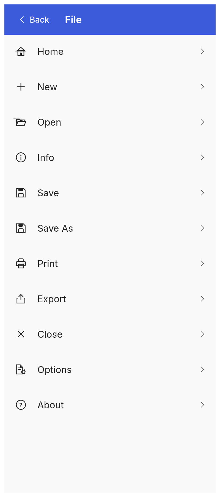
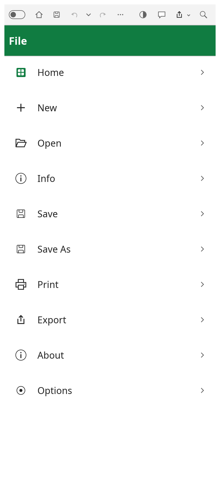
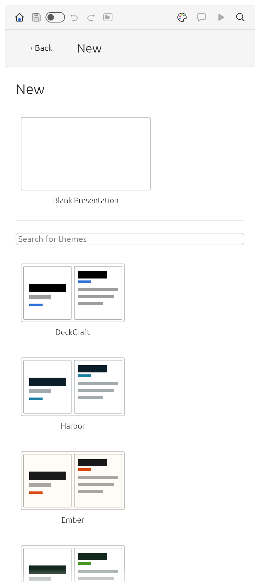

<div align="center">

# Rustina Office

**Full-Featured Desktop Office Suite, Rebuilt Lightweight in Rust for Android.**

Word Processor · Spreadsheet · Presentations

[English](README.md) · [فارسی](README.fa.md) · [Write](Write/README.md) · [Tables](Tables/README.md) · [Slides](Slides/README.md)

[-3ddc84?style=for-the-badge&logo=android&logoColor=white)](https://github.com/RustinaCo/Office/releases)
[](https://www.rust-lang.org/)
[](LICENSE)
[](https://github.com/RustinaCo/Office/releases/tag/v1.1.0)
[](#why-rustina-office)
[](#why-rustina-office)

### 📲 [Download Latest APKs (v1.1.0 Release)](https://github.com/RustinaCo/Office/releases/tag/v1.1.0)

| App | Purpose | Size | Direct Download |
| :--- | :--- | :--- | :--- |
| **Rustina Write** | Documents (`.docx`, `.odt`, `.txt`, `.pdf`) | **19.1 MB** | [⬇️ Download APK](https://github.com/RustinaCo/Office/releases/download/v1.1.0/Rustina-Write-1.1.0.apk) |
| **Rustina Tables** | Spreadsheets (`.xlsx`, `.csv`, `.tsv`, `.pdf`) | **9.4 MB** | [⬇️ Download APK](https://github.com/RustinaCo/Office/releases/download/v1.1.0/Rustina-Tables-1.1.0.apk) |
| **Rustina Slides** | Presentations (`.pptx`, `.pdf`, `.png`) | **13.0 MB** | [⬇️ Download APK](https://github.com/RustinaCo/Office/releases/download/v1.1.0/Rustina-Slides-1.1.0.apk) |

</div>

---

## 🚀 What's New in v1.1.0 (Mobile Gestures & BiDi Release)

- **Persian & Arabic (RTL) Layout Engine**:
  - Solved the word reversal display bug in Tables when typing Persian/Arabic sentences.
  - Implemented run-based bidirectional reordering (`unicode-bidi`) integrated with HarfBuzz shaping in cell rendering, cell editor measurement, and formula bar editing.
- **Two-Finger Pan & Gesture Navigation (Multi-Touch)**:
  - Native multi-touch pan (`multi_touch().translation_delta`) enabled across all applications.
  - Scroll horizontally and vertically simultaneously with two fingers without aiming for thin scrollbars.
- **Smart Touch Selection Disambiguation (Tables)**:
  - Single-finger drag now scrolls the spreadsheet view smoothly.
  - Rectangular cell range selection is performed via an enlarged 32px touch target fill handle.
- **Collapsible Ribbon by Default**:
  - In mobile portrait viewports, the top ribbon collapses by default, maximizing available document viewing space.
- **Presentation Slide Gestures (Slides)**:
  - Added two-finger swipe gestures to navigate slides forward and backward in full view, and pan smoothly in zoomed view.
- **Frame Pacing & Battery Optimization**:
  - Native event-driven loop (`ControlFlow::Wait`) ensures GPU and CPU throttle down to 0% idle when not touching, saving battery and preventing phone thermal throttling.
- **Clean Repository Architecture**:
  - Removed embedded APK binaries from git tracking, moving app packages exclusively to GitHub Releases.

---

## Why Rustina Office?

- **No account, ever.** Nothing to sign up for and nothing to sign into — there is no login between you and your file.
- **No ads, no telemetry, and no network permission at all.** Android will not let these apps phone home, because they never ask for the permission.
- **Small footprint.** 9.4 MB to 19 MB per app, complete fonts included — a fraction of the size of the mainstream suites.
- **Native file formats.** `.docx`, `.xlsx`, `.pptx` open, edit and save back in the exact same format.
- **Fully offline.** Edit, save, export to PDF and run slide shows in airplane mode. Nothing waits for a connection.
- **Your files stay where they are.** Open and save in any folder Android's file picker can see, including Google Drive, OneDrive, Nextcloud, Syncthing or local storage.
- **The whole desktop power, tuned for mobile.** The same ribbon tabs, formulas, and dialogs as desktop versions, optimized for touchscreen interaction.
- **Persian & RTL written properly.** Full support for right-to-left paragraphs, correct cursive letter joining and bidirectional runs, bundled with 22 open-licensed Persian/Arabic font families.

---

## The Applications

<div align="center">

| **[Rustina Write](Write/README.md)** | **[Rustina Tables](Tables/README.md)** | **[Rustina Slides](Slides/README.md)** |
|:---:|:---:|:---:|
| <a href="Write/README.md"></a> | <a href="Tables/README.md"></a> | <a href="Slides/README.md"></a> |
| **Word Processor** | **Spreadsheet Engine** | **Presentation Designer** |

</div>

- **[Rustina Write](Write/README.md)**: Styles, complete paragraph and page formatting, tables, columns, headers, footers, footnotes, comments, track changes, find & replace, navigation pane, table of contents, citations, and CSV mail merge.
- **[Rustina Tables](Tables/README.md)**: Cell styles, number formatting, conditional formatting, borders/fills, freeze panes, merge cells, fill handle, auto-filters, dependency-graph formula engine with **500+ functions**, dynamic arrays (`LET`, `LAMBDA`, `MAP`, `REDUCE`, `SCAN`), PivotTables, and 17 chart types.
- **[Rustina Slides](Slides/README.md)**: Slide masters, 11 layouts, 8 themes, sections, presenter notes, 150+ shapes, connectors, freeform drawing, gradient fills, transitions (including Morph), animations, and presenter view.

---

## How It Compares

| Feature | **Rustina Office** | Microsoft 365 Mobile | Google Docs / Sheets |
| :--- | :--- | :--- | :--- |
| **Account** | **None** | Microsoft account required | Google account required |
| **Price** | **Free (MIT)** | Free with limited features | Free for personal use |
| **Works Offline** | **Always (0 network permissions)** | Sign-in required | Files must be pre-synced |
| **Telemetry / Ads** | **Zero** | Microsoft diagnostics | Google usage tracking |
| **Download Size** | **9.4 – 19 MB** | 200+ MB per app | Heavy multi-service app |
| **File Formats** | **Native `.docx`, `.xlsx`, `.pptx`** | Native | Converted to Google format |

---

## Building from Source

```bash
# 1. Install toolchain & Android target
rustup target add aarch64-linux-android
cargo install cargo-apk2

# 2. Configure Android SDK / NDK environment
export ANDROID_HOME=$HOME/Android/Sdk
export ANDROID_NDK_HOME=$HOME/Android/Sdk/ndk/<version>

# 3. Build APK for any application (e.g. Tables):
cd Tables/grid-android
cargo apk2 build --lib --release
```

---

## License

Distributed under the **MIT License**. See [`LICENSE`](LICENSE) for details. Full acknowledgments and upstream credits are documented in [`CREDITS.md`](CREDITS.md).
