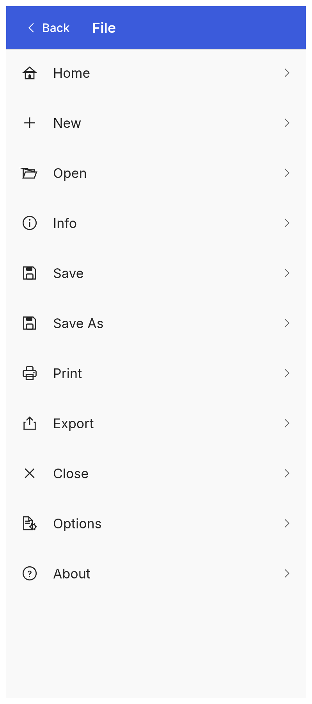
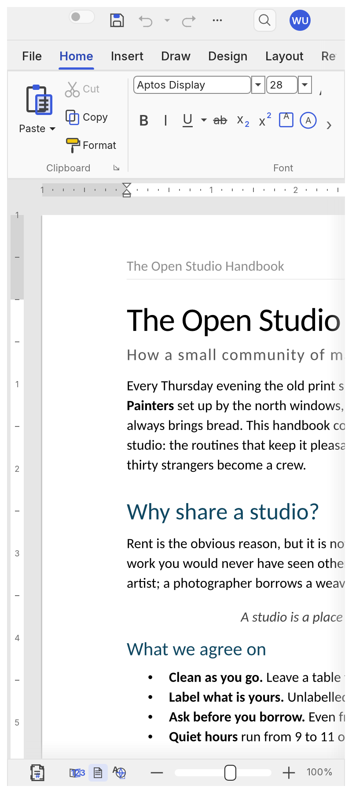
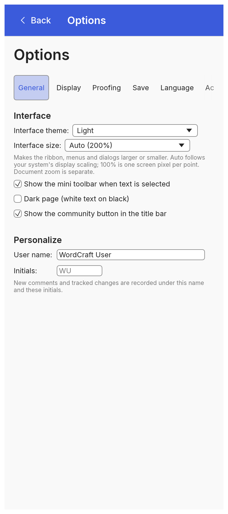

<div align="center">

# Rustina Office

**Microsoft Office, on your phone — the same three apps, the same ribbon, the same options as the
desktop, rebuilt lightweight for Android.**

[English](README.md) · [فارسی](README.fa.md) · [Word](Word/README.md) · [Excel](Excel/README.md) · [PowerPoint](PowerPoint/README.md)

-3ddc84?style=flat-square&logo=android&logoColor=white)


</div>

---

## What this is

Rustina Office is three Android apps that bring the desktop workflow you already know to a phone:

| App | What it is | Open | Save |
|---|---|---|---|
| **[Rustina Word](Word/README.md)** | A word processor — documents, styles, tables, track changes, references, mail merge | `.docx`, `.txt`, `.md`, `.html`, `.rtf`, `.odt` | `.docx`, `.pdf`, `.txt`, `.html` |
| **[Rustina Exel](Excel/README.md)** | A spreadsheet — formulas, formatting, tables, charts, data tools | `.xlsx`, `.csv` | `.xlsx`, `.csv`, `.pdf` |
| **[Rustina PowerPoint](PowerPoint/README.md)** | Presentations — themes, layouts, shapes, pictures, charts, transitions, animations, slide shows | `.pptx` | `.pptx`, `.pdf` |

The whole suite is written in **Rust** — one engine, one UI, three apps — and the Android build reuses
the *same* desktop front end: the ribbon, the tabs, the dialogs and every option are the ones from the
desktop apps, laid out for a touch screen. Nothing is a stripped-down "mobile edition".

<div align="center">

| File page | Document | New document | Options |
|---|---|---|---|
|  |  |  |  |

</div>

## Why people use it

- **Manage your laptop's files from your phone, anywhere, without any hassle.** If the folder you work
  in is synced to the phone (Google Drive, OneDrive, Dropbox, Nextcloud, Syncthing, a NAS…) the apps
  open and save straight into it through the system file manager — there is no import/export dance,
  no "share to the app, edit, share back".
- **All options exactly like the desktop.** The same ribbon tabs, the same dialogs, the same settings.
  If you know Word, Excel or PowerPoint, you already know these apps.
- **Light and fast.** A native Rust binary. It starts in a moment, scrolls at the display's frame rate
  and is a fraction of the size of the alternatives — the whole app is a few megabytes, fonts and all.
- **Your writing is safe.** AutoSave keeps the file up to date, and Android's Back button asks
  *Save / Don't Save / Cancel* before a document with unsaved changes is closed — exactly like closing
  it on a computer.
- **Persian, Arabic and other scripts, done properly.** 22 open-licensed Persian/Arabic font families (and five metric-compatible Latin ones)
  ship in the box, right-to-left text is laid out correctly, and any font you own can be added with
  **Add Font…** and stays installed for good.

## Install

1. Download the APK you want from the [**v1.0.0 release**](https://github.com/RustinaCo/Office/releases/tag/v1.0.0)
   (or from [`apk/`](apk) at that tag).
2. Open it on the phone and allow installing from this source when Android asks.
3. That's it — no account, no ads, no telemetry, no network permission.

**Requirements:** Android 10 (API 29) or newer, arm64-v8a. The app asks only for the files you hand it
through the system picker.

## What the phone build changes

Everything below is on top of the desktop apps; the desktop layout is untouched.

- **The File page, rebuilt for the thumb.** Phones open on **File**: a full-screen list of destinations
  (Home, New, Open, Info, Save, Save As, Print, Export, Close, Options, About). Tap one and you get that
  one page, big and full screen; **Back** returns to the list. The old launch menu is gone.
- **Android's Back button behaves.** It closes the keyboard first, then the page or dialog on top, and
  in the document it asks **Save / Don't Save / Cancel** when there is unsaved work. Back on the File
  screen with nothing open leaves the app.
- **AutoSave that actually saves.** Once the document has a file, the AutoSave switch in the title bar
  turns on and keeps writing it — including the copy the app keeps for itself, so nothing is lost even
  if the phone is put away mid-edit.
- **A keyboard that stays put.** Tapping the page raises the keyboard; tapping a toolbar button, a menu
  or any other control puts it away and keeps it away. Typing, selection and the mini toolbar are
  untouched.
- **Large touch targets.** Big, tall ribbon buttons on every tab except Home (which keeps the real
  two-row layout), pill-shaped tab tokens, and a footer with the page and zoom controls.

## Screenshots

<table>
  <tr>
    <td align="center"><br><sub>File</sub></td>
    <td align="center"><br><sub>Editing</sub></td>
    <td align="center"><br><sub>New</sub></td>
    <td align="center"><br><sub>Options</sub></td>
  </tr>
</table>

Word's desktop build is in the same source, unchanged:


## Building from source

Each folder is a self-contained pair: the cross-platform app plus its Android shell. The only thing
they need from outside is the folder of bundled fonts, which is inside each app folder.

```bash
# toolchain
rustup target add aarch64-linux-android
cargo install cargo-apk

# Android SDK/NDK, then, in any app folder's android/ directory:
cd Word/word-android
export ANDROID_HOME=$HOME/Android/Sdk
export ANDROID_NDK_ROOT=$HOME/Android/Sdk/ndk/<version>
cargo apk build --lib --release     # cargo-apk ≥ 0.10: `cargo apk2 build --lib --release`
```

For the desktop build of an app, `cargo run --release -p wordcraft` (or `gridcraft`, `deckcraft`) in
its app folder works on Linux, macOS, Windows and BSD, and the same crates compile to WebAssembly.

## Credits

This suite stands on the **ArtCraft team**'s open-source work — the original clean-room
WordCraft / GridCraft / DeckCraft engine and interface — released under MIT OR Apache-2.0. Thank you.
Full credit, links and licence texts: [`CREDITS.md`](CREDITS.md).

## Contributing

Contributions are very welcome — this is a young fork of a big codebase:

- **Bug reports** with the phone model, the Android version and what you did.
- **Translations** (the interface is translated; Persian and English come first).
- **Fonts**: more open-licensed families for Persian, Arabic, Urdu and the other scripts.
- **Pull requests**: please keep the desktop layout working, and add a test or a screenshot with the
  change.

Open an [issue](https://github.com/RustinaCo/Office/issues) or a pull request. By contributing you
agree your work is licensed under the MIT licence below.

## License

MIT — see [`LICENSE`](LICENSE). The upstream apps are MIT OR Apache-2.0; their texts are kept next to
the source in each app folder (`LICENSE-MIT`, `LICENSE-APACHE`).

Microsoft, Word, Excel and PowerPoint are trademarks of Microsoft Corporation. This project is an
independent, clean-room open-source implementation and is not affiliated with, endorsed by or
sponsored by Microsoft.
