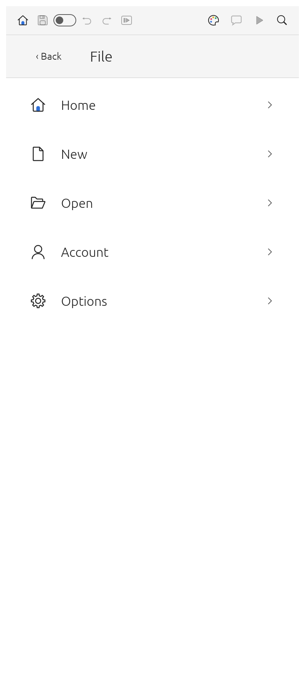
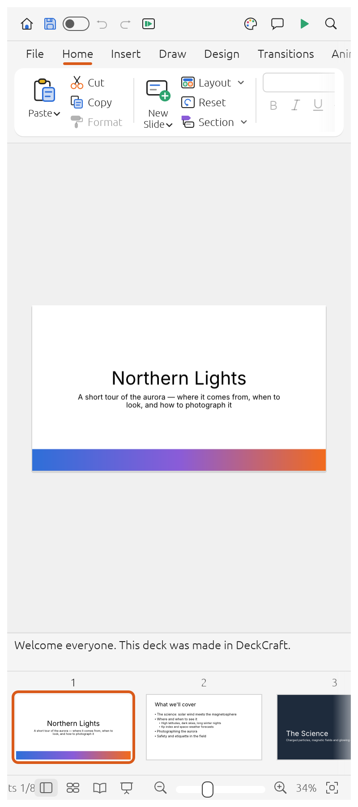
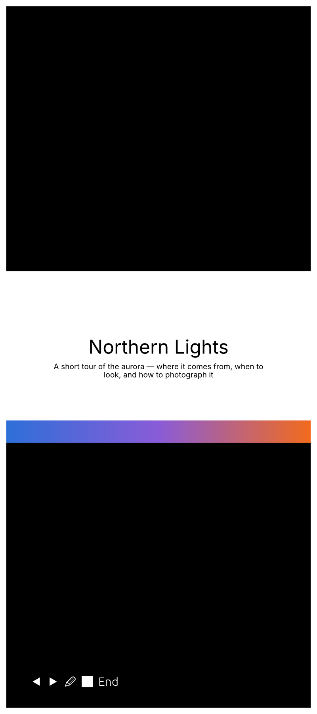
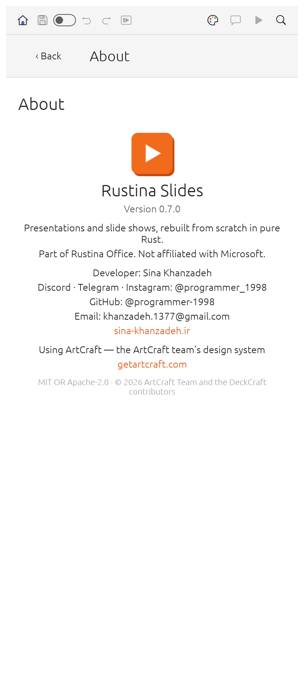

<div align="center">

# Rustina Slides

**Presentations for Android — the PowerPoint workflow you know, in your pocket.**

[← Rustina Office](../README.md) · [English](README.md) · [فارسی](#فارسی)

-3ddc84?style=flat-square&logo=android&logoColor=white)


</div>

---

Rustina Slides is the presentation app of the [Rustina Office](../README.md) suite: a native
Android app with the desktop ribbon, the desktop dialogs and every desktop option, laid out for a
touch screen. It opens and saves PowerPoint `.pptx` files and presents them full screen.

> The Android app is *Rustina Slides*, package `net.craftsuite.deckcraft`; the source is
> `deckcraft/` and its Android shell `deck-android/`. It is in alpha: the deck features below are all there, but expect rough edges — please report them.

<table>
  <tr>
    <td align="center"><br><sub>The File page</sub></td>
    <td align="center"><br><sub>Editing a slide</sub></td>
    <td align="center"><br><sub>Slide show</sub></td>
    <td align="center"><br><sub>About</sub></td>
  </tr>
</table>

The **New presentation** gallery is shown in the [Rustina Office README](../README.md).

**First release** — hit a bug? [Open an issue](https://github.com/RustinaCo/Office/issues) with what you did, your phone model and your Android version, and it gets fixed quickly.

**Download:** [`apk/Rustina-Slides-1.0.2.apk`](https://github.com/RustinaCo/Office/raw/v1.0.3/apk/Rustina-Slides-1.0.2.apk) — Android 10 (API 29) or
newer, arm64. Or build it yourself ([below](#building)).

## What it does

- **Make decks**: slide masters and eleven layouts with placeholders that inherit position and
  formatting, eight original themes with colour and font schemes, sections, notes, comments, headers
  and footers, custom slide sizes.
- **Draw**: 150+ preset shapes with adjust handles, connectors that stay glued to shapes, freeform,
  curve and scribble tools, merge shapes (union, combine, fragment, intersect, subtract), gradient,
  picture and pattern fills, outlines with dashes and arrowheads, shadows, glow, soft edges and
  reflections.
- **Write**: in-place text editing with full font and paragraph formatting, bullets and numbering,
  columns, autofit, vertical text, fields and hyperlinks.
- **Add content**: pictures with crop and corrections, tables with styles, charts, SmartArt basics,
  audio and video (MP3, AAC, FLAC, ALAC, Ogg, Opus, WAV, AIFF; H.264, HEVC, VP9, AV1).
- **Present**: transitions (including Morph), entrance/emphasis/exit and motion-path animations,
  by-paragraph builds, a full-screen slide show, presenter view, a pen, rehearse timings, media
  playback.
- **Files**: opens and saves `.pptx`; exports PDF (slides, notes pages, handouts with selectable
  text), PNG/JPEG and outlines. Unsaved work is kept by AutoRecover.

## On a phone

- **It opens on File.** A full-screen list of destinations — Home, New, Open, Info, Save, Save As,
  Print, Export, About, Options — the same list on the app's first screen and when you tap **File**
  from the presentation. Tap one for its own full-screen page; **Back** returns to the list. On the
  list itself **Back** is shown whenever there is a presentation behind it to step into; on the app's
  first screen it is not, and Back there leaves the app. Close is Android's Back, and Account is
  desktop-only here, so neither is a phone row.
- **The footer toggles the slide panel.** The first icon in the footer shows and hides the pane of
  all slides — tap it to fold the pane away and get the whole screen for the slide, tap it again to
  bring it back (the icon shows whether the pane is open). There is no floating button in the way of
  the slide.
- **Android's Back button.** It closes the keyboard first, then the topmost page or dialog. In the
  presentation, if there is unsaved work it asks **Save / Don't Save / Cancel** — the same question
  the desktop app asks when you close a deck — and after it is closed you land on the File page.
- **AutoSave that works.** Once the deck has been saved somewhere, the AutoSave switch in the title
  bar turns on and keeps writing the file as you work; the app keeps its own working copy too.
- **A keyboard that stays where you put it.** Tap the slide or a text box and the keyboard comes up;
  tap a ribbon button or a menu and it goes away and stays away.
- **Presenting** works the way you would want on a phone: full screen, landscape, tap (or swipe) to
  advance, pen, and the animations and transitions the deck defines.

## Templates

New presentations come from a gallery of original designs — distinct colour stories, backgrounds,
title layouts and type scales — rather than a set of pale copies. **They are ours**: every template is
drawn from the app's own theme and shape code. (The app deliberately contains no Microsoft template,
theme, icon or artwork: see the note below.)

## Persian, Arabic and right-to-left

22 open-licensed Persian/Arabic families are bundled (Vazirmatn, Noto Naskh Arabic, Noto Sans Arabic,
Cairo, Tajawal, Sahel, Samim, Shabnam, Tanha, Gandom, Nahid, Parastoo, Estedad, Almarai, Lalezar,
Katibeh, Aref Ruqaa, Amiri, Markazi Text, Mirza, Noto Nastaliq Urdu, Scheherazade New) along with five
metric-compatible Latin families (Carlito ≈ Calibri, Arimo ≈ Arial, Tinos ≈ Times New Roman,
Cousine ≈ Courier New, Caladea ≈ Cambria).

Right-to-left paragraphs and bidi text work in placeholders and text boxes; the commercial Iranian
families (**B Nazanin, B Titr, B Yekan, IRANSans**…) can be added with **Add Font…** — install the
font yourself and it stays in the font list.

## Notes worth knowing

- **Android 10 (API 29) or newer, arm64.** The APK is signed for sideloading; there is no Play Store
  version.
- **Alpha.** Slide editing, presenting and the file format are solid; some of the deeper desktop
  features are still being finished. Save early, save often (AutoSave and AutoRecover help).
- **The app only sees the files you hand it** through Android's file picker — including cloud
  providers (Google Drive, OneDrive, Dropbox, Nextcloud, a NAS…), so a deck in your laptop's synced
  folder can be opened and presented from anywhere.
- **It keeps a copy of what you save** in its own private folder, which is what makes AutoSave work
  when the chosen file lives in the cloud; the app writes your file back too, so both stay in step.
- **No Microsoft assets, on purpose.** No PowerPoint template, theme, icon or clip art is copied,
  traced or recreated anywhere in this app; everything is drawn in code or original.
- **The desktop build is in the same source**: `cargo run --release -p deckcraft` in `deckcraft/`.

## Building

```bash
cargo install cargo-apk
rustup target add aarch64-linux-android

cd deck-android
export ANDROID_HOME=$HOME/Android/Sdk
export ANDROID_NDK_ROOT=$HOME/Android/Sdk/ndk/<version>
cargo apk2 build --lib --release          # cargo-apk ≥ 0.10; older: cargo apk build
```

The APK lands in `deck-android/target/release/apk/`. Package `net.craftsuite.deckcraft`, label
*Rustina Slides*, minSdk 29, targetSdk 35.

- `deckcraft/` — the app (engine, PPTX I/O, renderer, textures, UI)
- `deck-android/` — the Android shell
- `fonts/` — the bundled open-licensed fonts, compiled into the APK

## Credits and license

Rustina Slides is the [ArtCraft team](https://getartcraft.com/)'s open-source **DeckCraft** —
engine, shape and theme code, PPTX support and 99% of everything above — with the Android shell, the
phone work and the template gallery added here. Thank you, ArtCraft. MIT OR Apache-2.0; the licence
texts are in `deckcraft/`, and [`../CREDITS.md`](../CREDITS.md) has the full story. Fonts are OFL,
listed in `fonts/ATTRIBUTION.md`.

Microsoft and PowerPoint are trademarks of Microsoft Corporation. This is an independent, clean-room
implementation, not affiliated with or endorsed by Microsoft.

<div dir="rtl">

## فارسی

**Rustina Slides** برنامهٔ ارائهٔ اندرویدی مجموعهٔ رستینا آفیس است: همان ریبون و تنظیمات نسخهٔ
کامپیوتری، چیده‌شده برای صفحهٔ لمسی.

- `pptx` را باز و ذخیره می‌کند و `pdf` (اسلاید، صفحهٔ یادداشت، جزوه) و تصویر می‌سازد.
- تم‌ها، چیدمان‌ها، ۱۵۰+ شکل، نمودار، جدول، تصویر، انتقال‌ها، انیمیشن‌ها و نمایش تمام‌صفحه.
- روی گوشی با **File** باز می‌شود؛ **Back** اول کیبورد را می‌بندد و در صورت تغییر ذخیره‌نشده
  **ذخیره / ذخیره نکن / لغو** می‌پرسد.
- اولین آیکن فوتر پنل همهٔ اسلایدها را باز و بسته می‌کند (بدون دکمهٔ شناور روی اسلاید).
- قالب‌های آماده، طرح‌های اورجینال و متفاوت‌اند؛ هیچ قالب یا آیکن مایکروسافتی کپی نشده است.
- **ذخیرهٔ خودکار** پس از اولین ذخیره کار می‌کند و ۲۲ فونت فارسی/عربی همراه برنامه است.
- اندروید ۱۰ یا بالاتر، arm64.

با تشکر از **تیم ArtCraft** سازندگان متن‌باز DeckCraft. مجوز MIT.

</div>
