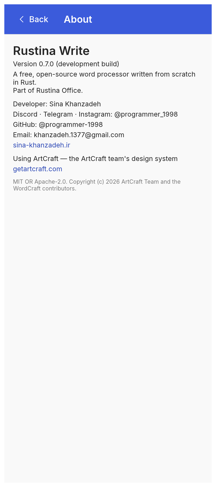
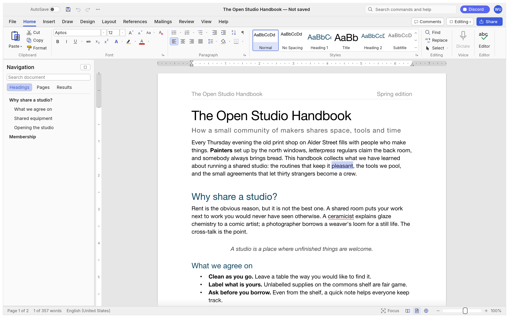

<div align="center">

# Rustina Write

**A word processor for Android — the Word workflow you know, in your pocket.**

[← Rustina Office](../README.md) · [English](README.md) · [فارسی](#فارسی)

-3ddc84?style=flat-square&logo=android&logoColor=white)


</div>

---

Rustina Write is the word processor of the [Rustina Office](../README.md) suite: a native Android app with
the desktop ribbon, the desktop dialogs and every desktop option, laid out for a touch screen. It
opens and saves the file formats you already have.

<table>
  <tr>
    <td align="center"><br><sub>Editing</sub></td>
    <td align="center"><br><sub>New document</sub></td>
    <td align="center"><br><sub>Options</sub></td>
    <td align="center"><br><sub>About</sub></td>
  </tr>
</table>

The **File page** the app opens on is the same on all three apps and is shown in the
[Rustina Office README](../README.md).

**First release** — hit a bug? [Open an issue](https://github.com/RustinaCo/Office/issues) with what you did, your phone model and your Android version, and it gets fixed quickly.

**Download:** [`apk/Rustina-Write-1.0.2.apk`](https://github.com/RustinaCo/Office/raw/v1.0.2/apk/Rustina-Write-1.0.2.apk) — Android 10 (API 29) or
newer, arm64. Or build it yourself ([below](#building)).

## What it does

- **Documents**: styles, fonts and full paragraph formatting, tables, columns, headers and footers,
  sections and page setup, lists, footnotes and endnotes, bookmarks, comments, track changes,
  find and replace, spell check, a mini toolbar on selection and a styles gallery.
- **Long documents**: a navigation pane, outline levels, a table of contents, captions, cross
  references, an index, citations and a bibliography, a mail merge with CSV recipients.
- **Objects**: pictures (with crop, wrap and effects), shapes and text boxes, WordArt, charts,
  equations, symbols, SmartArt basics, hyperlinks and cross-references.
- **Files**: opens `.docx`, `.txt`, `.md`, `.html`, `.rtf` and `.odt`; saves `.docx`, exports to
  `.pdf`, `.txt` and `.html`. Files come and go through Android's own file manager, so a document in
  Google Drive, OneDrive, Dropbox, Nextcloud or on a NAS opens like any other file.
- **Also here**: dark mode, the ribbon exactly as the desktop shows it, and the same document engine
  as the desktop app, so a `.docx` that round-trips on a computer round-trips here.

## On a phone

- **It opens on File.** A full-screen list of destinations — Home, New, Open, Info, Save, Save As,
  Print, Export, About, Options — the same list on the app's first screen and when you tap **File**
  from the document. Tap one for its own full-screen page; **Back** returns to the list. (No launch
  menu to wade through, and no Close row: on a phone Android's Back closes the document.)
- **Android's Back button.** It closes the keyboard first, then the topmost page or dialog. In the
  document, if there is unsaved work it asks **Save / Don't Save / Cancel** — the same question the
  desktop app asks when you close a document — and after the document is closed you land on the File
  page, not on a blank screen.
- **AutoSave that works.** Once the document has been saved somewhere, the AutoSave switch in the
  title bar turns on; it keeps writing the file as you work. The app also keeps its own working copy
  of every save, so an AutoSave never depends on a file provider that has gone to sleep.
- **A keyboard that stays where you put it.** Tap the page and the keyboard comes up. Tap Bold, a
  menu or any other toolbar control and it goes away and stays away, instead of closing and popping
  straight back up.
- **Big targets**: tall ribbon buttons on every tab except Home (which keeps the real two-row
  layout), pill-shaped tab tokens, and a footer with the page and zoom controls.
- **A Bluetooth keyboard works.** The desktop shortcuts — <kbd>Ctrl</kbd>+<kbd>B</kbd>,
  <kbd>Ctrl</kbd>+<kbd>S</kbd>, <kbd>Ctrl</kbd>+<kbd>Z</kbd>, <kbd>Alt</kbd>+<kbd>Q</kbd> for the
  command search and the rest — are all there.

## Persian, Arabic and right-to-left

The app ships with 22 open-licensed Persian/Arabic families — Vazirmatn, Noto Naskh Arabic, Noto
Sans Arabic, Cairo, Tajawal, Sahel, Samim, Shabnam, Tanha, Gandom, Nahid, Parastoo, Estedad, Almarai,
Lalezar, Katibeh, Aref Ruqaa, Amiri, Markazi Text, Mirza, Noto Nastaliq Urdu and Scheherazade New —
plus five metric-compatible Latin families (Carlito ≈ Calibri, Arimo ≈ Arial, Tinos ≈ Times New
Roman, Cousine ≈ Courier New, Caladea ≈ Cambria).

Right-to-left paragraphs, bidi text and Arabic shaping are handled by the same layout engine the
desktop app uses.

The commercial Iranian families (**B Nazanin, B Titr, B Yekan, IRANSans, IranNastaliq**…) cannot be
bundled — they are not open-licensed. If you own one, install the font on the phone (or pick it with
**Font ▸ Add Font…** inside the app) and it becomes available in the font list for good.

## Notes worth knowing

- **Android 10 (API 29) or newer, arm64.** The APK is signed for sideloading; there is no Play Store
  version.
- **The app only sees the files you hand it.** It asks for nothing until you open or save a file, and
  it never touches the rest of your storage.
- **It keeps a copy of what you save** in its own private folder. That is what makes AutoSave possible
  when the file you chose lives in a cloud provider; the app also writes your file back, so both stay
  in step.
- **Opening a file from a cloud provider copies it in first.** Editing happens on a local copy, which
  is what keeps the UI instant on a phone.
- **The desktop build is in the same source.** `cargo run --release -p wordcraft` in `wordcraft/`
  builds the same app for Linux, macOS, Windows and BSD, and the same crates compile to the web.



## Building

```bash
cargo install cargo-apk
rustup target add aarch64-linux-android

cd word-android
export ANDROID_HOME=$HOME/Android/Sdk
export ANDROID_NDK_ROOT=$HOME/Android/Sdk/ndk/<version>
cargo apk2 build --lib --release          # cargo-apk ≥ 0.10; older: cargo apk build
```

The APK lands in `word-android/target/release/apk/`. Package `net.craftsuite.wordcraft`, label
*Rustina Write*, minSdk 29, targetSdk 35.

- `wordcraft/` — the app (engine, document model, layout, renderer, PDF, UI)
- `word-android/` — the Android shell (activity, file picker, IME overlay, system bars)
- `fonts/` — the bundled open-licensed fonts, compiled into the APK

## Credits and license

Rustina Write is the [ArtCraft team](https://getartcraft.com/)'s open-source **WordCraft** — engine,
UI, document model and 99% of everything above — with the Android shell and the phone work added
here. Thank you, ArtCraft. MIT OR Apache-2.0; the licence texts are in `wordcraft/`, and
[`../CREDITS.md`](../CREDITS.md) has the full story. Fonts are OFL, listed in `fonts/ATTRIBUTION.md`.

Microsoft and Word are trademarks of Microsoft Corporation. This is an independent, clean-room
implementation, not affiliated with or endorsed by Microsoft.

<div dir="rtl">

## فارسی

**Rustina Write** واژه‌پرداز اندرویدی مجموعهٔ رستینا آفیس است: همان ریبون، همان پنجره‌ها و همان
تنظیمات نسخهٔ کامپیوتری، چیده‌شده برای صفحهٔ لمسی.

- `docx` و `txt` و `md` و `html` و `rtf` و `odt` را باز می‌کند و `docx`/`pdf`/`txt`/`html` ذخیره می‌کند.
- روی گوشی با **File** باز می‌شود: لیست تمام‌صفحهٔ مقصدها؛ هر مقصد صفحهٔ خودش را دارد و **Back** به
  لیست برمی‌گردد.
- **Back** اندروید اول کیبورد، بعد صفحهٔ رویی، و داخل سند اگر تغییر ذخیره‌نشده باشد
  **ذخیره / ذخیره نکن / لغو** می‌پرسد.
- **ذخیرهٔ خودکار** پس از اولین ذخیره فعال می‌شود و واقعاً فایل را به‌روز نگه می‌دارد.
- ۲۲ خانوادهٔ فونت فارسی/عربی با مجوز باز همراه برنامه است؛ فونت‌های تجاری مثل B Nazanin و B Titr
  را خودت با **افزودن فونت…** اضافه کن — همیشه نصب می‌ماند.
- اندروید ۱۰ یا بالاتر، arm64. سورس نسخهٔ دسکتاپ هم در همین پوشه است.

با تشکر از **تیم ArtCraft** سازندگان متن‌باز WordCraft. مجوز MIT.

</div>
